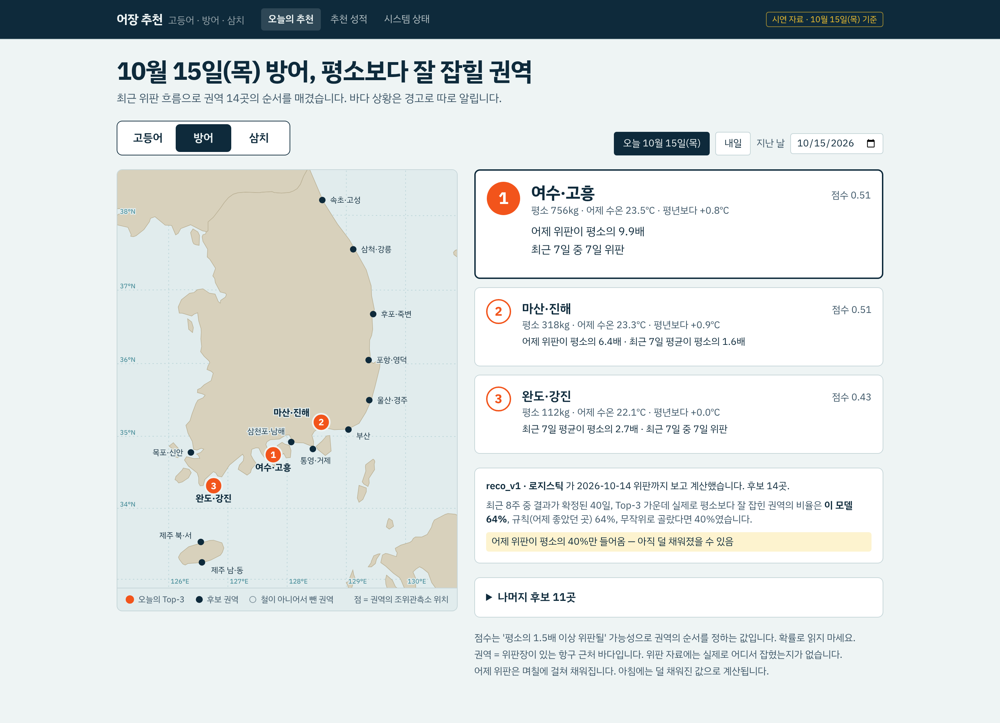

# 어장 위치 추천 서비스 (fishing-ground-reco)

AI·데이터 기반 해양·수산 서비스 개발자 과정 **U3-P 프로젝트 부록**. 실습 U3-P7 에서 설계한 어장 추천을
회원 · 화면 · AI 서버 · 재학습 · 자동 교체 · RAG 가 모두 돌아가는 서비스로 완성한 참고 구현이다.

> “내일 방어는 어느 권역이 평소보다 잘 잡힐까?” → 권역 14곳 중 Top-3 와 근거 · 경고 · 뺀 이유,
> 그리고 지나고 나서 정말 맞았는지까지.



## 한눈에

| 폴더 | 무엇 | 기술 | 주소 |
|---|---|---|---|
| `web/` | 화면 | Next.js 16.4 · React 19.3 · TypeScript 6.0 · Tailwind CSS 4.3 | http://localhost:3000 |
| `api/` | 서비스 서버 — 회원 · 추천 조회 · RAG 중계 · 관리자 | Spring Boot 4.1.3 · Java 21 · Gradle (설정은 `build.gradle` · `application.properties`) | :8080 |
| `ai/` | AI 서버(FastAPI) + 작업 프로세스(수집 · 추천 계산 · 채점 · 재학습 · 교체) | Python 3.12+ · FastAPI · scikit-learn · APScheduler | :8000 |
| `db/` | `reco` 스키마의 표 · 뷰 (`app` 스키마는 Spring Flyway) | MariaDB 10.11+ | :3306 |
| `scripts/` | 실행 · 점검 · E2E · 교안 캡처 · 모의 소셜 로그인 서버 | bash · PowerShell · Node · Python | |
| `docs/` | 단계별 안내 · 교안 캡처 60장 · 실습 P7 문서 | | |

```
 브라우저 ─▶ Next.js(:3000) ──/api · /oauth2 넘김──▶ Spring(:8080) ── app: 회원 · 피드백 · 질문 기록
                                                      │ reco.v_svc_* 뷰 읽기
                                                      └─X-Internal-Token─▶ FastAPI(:8000) ── reco: 수집 · 학습 · 추천 · RAG
                                         작업 프로세스(reco.worker) ── 정해진 시각 + 관리자 요청 대기열 ─┘
```

숫자의 출발점은 실습 U3-P5 · P6 — 시험 P@3 로지스틱 0.606 · 규칙(어제 좋았던 곳) 0.601 · 무작위 0.349.
모델과 규칙은 **같은 수준**이고, 이 서비스는 그 사실을 화면에 그대로 보여 준다.

## 단계와 안내 문서

| 단계 | 내용 | 안내 | 캡처 |
|---|---|---|---|
| 0 · 1 | 저장소 · DB · 네 부분 health · 추천 미리 계산 · Spring 추천 API · 해도 화면 | [01_뼈대_추천서비스](docs/guide/01_뼈대_추천서비스.md) | phase0 3 · phase1 5 |
| 2 | 회원: 이메일 인증 · 재설정 · 카카오 · 네이버 · 구글 · 계정 연결 · 관리자 | [02_회원](docs/guide/02_회원.md) | phase2 23 |
| 3 | 수집 · 재학습 · 자동 교체(조건 5개) · 되돌리기 · 관리자 화면 | [03_수집_재학습_교체](docs/guide/03_수집_재학습_교체.md) | phase3 14 |
| 4 | RAG: ‘왜 이 권역인가요?’ 근거 설명 · 물어보기 | [04_RAG](docs/guide/04_RAG.md) | phase4 9 |
| 5 | 추천 성적 · 피드백 · 이용 기록 · 점검(E2E) | [05_성적_피드백_점검](docs/guide/05_성적_피드백_점검.md) | phase5 6 |

각 안내 문서 끝에 그 단계에서 실제로 만난 문제와 고친 방법을 적었다 (h2c 업그레이드로 사라진 POST 본문,
한 번에 몰려오던 스트림, 거절된 소셜 연결 뒤의 세션 주인 등).

## 처음 설치 (한 번)

1. MariaDB 10.11 이상, Java 21, Node.js 20.9 이상, Python 3.12 이상, 개발용 메일함 [Mailpit](https://mailpit.axllent.org) 을 설치한다.
   RAG 를 LLM 으로 돌리려면 [Ollama](https://ollama.com) 를 설치하고 `ollama pull qwen3:1.7b`.
2. `.env.example` 을 `.env` 로 복사하고 비밀번호 · `INTERNAL_TOKEN` · `ADMIN_EMAILS` 를 채운다. **`.env` 는 올리지 않는다.**
3. AI 쪽
   ```bash
   cd ai
   python -m venv .venv
   .venv/bin/pip install -r requirements.txt          # Windows: .venv\Scripts\pip
   .venv/bin/python scripts/init_db.py                # 데이터베이스 reco · app, 계정 reco_ai · reco_api, 표 · 뷰 · 권한
   .venv/bin/python -m reco.jobs run bootstrap_demo   # 시연 자료 → reco_v1 → 7/1~오늘 추천 → 채점 (약 15초)
   ```
4. 화면 쪽: `cd web && npm install`
5. Spring 은 처음 실행할 때 Gradle 이 라이브러리를 받는다.
6. (점검 · 캡처용) `npm i -g playwright && npx playwright install chromium`

## 실행

```bash
scripts/start_all.sh            # Windows: powershell -ExecutionPolicy Bypass -File scripts\start_all.ps1
```

AI 서버 · 작업 프로세스 · Spring · 화면 · (있으면) Mailpit · 모의 소셜 로그인 서버가 뜬다.
http://localhost:3000/status 에서 네 부분이 모두 ‘정상’인지 확인한다.

| 기본 프로필 `demo,mockoauth` | 실제 운영 |
|---|---|
| 로그인 화면의 **시연 사용자 · 시연 관리자** | `PROFILES=demo` 또는 빈 값, 시연 로그인은 404 |
| 모의 카카오 · 네이버(:9100, 화면에 ‘교육용 모의 서버’ 표시) | 각 개발자 센터 키 → `.env` ([2단계 안내](docs/guide/02_회원.md#실제-키로-바꾸기)) |
| 메일은 Mailpit http://localhost:8025 | `MAIL_HOST` 등 SMTP 설정 |
| `DEMO_TODAY=2026-10-15` — 날짜 고정, 수집은 받아 둔 원본 ‘재생’ | `DEMO_TODAY` 비우고 `DATA_GO_KR_KEY` · `KMA_AUTH_KEY` |
| RAG `LLM_BACKEND=ollama`(모델이 없으면 근거 문장 모음으로 바꿔 탐) | ollama · openai · claude 중 고르기 |

## 둘러보기 (시연)

1. **오늘의 추천** — 방어 Top-3, 해도, 뺀 권역과 이유, 최근 8주 성적. 로그인하면 ‘왜 이 권역인가요?’ 와 피드백.
2. **추천 성적** — 보여 드린 추천 · 규칙 · 무작위, 주별 그림, 날마다 맞은 권역.
3. **물어보기** — 추천 원리 · 용어 · 특보 · 수칙(수업용 예시). 근거가 없으면 없다고 답한다.
4. **관리자**(시연 관리자) — 재학습 → **거절**, 시연: 약한 챔피언 → 재학습 → **교체**, 되돌리기, 수집 실패 흉내 → **조건 1 거절**,
   이용 기록. 순서는 [3단계 안내 4절](docs/guide/03_수집_재학습_교체.md#4-세-가지-결과를-화면에서-재현하기-시연).
5. 처음 상태로: `ai/.venv/bin/python -m reco.jobs run bootstrap_demo`

## 점검

```bash
scripts/test_all.sh             # 단위(pytest 25 · gradle 11 · vitest 3) → 통합 check_all 13 → 화면 E2E 13
```

각각 따로: `ai/.venv/bin/python scripts/check_all.py` · `node scripts/e2e/e2e.mjs` · `ai/.venv/bin/python scripts/check_auth.py`(회원 흐름 34개)

## 교안 캡처

```bash
node scripts/capture/capture.mjs all     # 또는 0 · 1 · 2 · 3 · 4 · 5
```

`docs/captures/phase<N>/<번호>-<장면>-pc.png · -mobile.png` (PC 1440px ×2 · 휴대폰 iPhone 13). 3단계는 시작과 끝에
시연 상태를 처음으로 되돌리므로 몇 번 돌려도 같은 장면이 나온다. 장면 목록은 각 단계 안내 문서 끝에 있다.

> 4단계 캡처는 LLM 을 쓸 수 없는 환경에서 `LLM_BACKEND=mock`(근거 문장 모음)으로 찍었다. Ollama 를 켠 PC 에서
> `node scripts/capture/capture.mjs 4` 를 다시 돌리면 같은 장면이 LLM 답으로 찍힌다.

## 문제가 생기면

| 증상 | 확인 |
|---|---|
| /status 에서 AI 서버 ‘연결 안 됨’ | `INTERNAL_TOKEN` 이 `.env` 에 있나 (비면 FastAPI 가 내부 API 를 닫는다 → 503) |
| Spring 이 뜨지 않음 · `client id` 오류 | `.env` 의 소셜 키 줄이 빈 값으로 열려 있지 않나 — 쓰지 않는 제공자는 주석(`#`) 그대로 |
| 가입했는데 메일이 안 옴 | Mailpit 이 1025 에서 받는 중인가, 화면 http://localhost:8025 |
| 관리자 버튼을 눌러도 ‘대기’에서 안 움직임 | 작업 프로세스(`python -m reco.worker`)가 떠 있나 — 10초마다 대기열을 본다 |
| 설명 · 물어보기에 ‘Ollama 에 연결할 수 없습니다’ | `ollama serve` · `ollama pull qwen3:1.7b`. 그동안은 근거 문장 모음으로 답한다 |
| ‘질문은 1분에 5번까지’ | `RAG_PER_MINUTE` (회원 한 명 기준) |
| 화면이 ‘불러오는 중…’ 에 멈춤 | 빌드를 다시 했다면 예전 `next start` 프로세스를 끄고 다시 |

## 보안 메모

- 키 · 비밀번호는 모두 `.env`(올리지 않음) → 환경 변수. 저장소 · 캡처 · 문서에 실제 키를 넣지 않는다.
- 비밀번호는 bcrypt, 메일 링크 토큰은 SHA-256 해시만 저장 · 1회용. 세션은 HttpOnly 쿠키, CSRF 는 쿠키 → 헤더.
- 비밀번호 재설정 · 변경 · 탈퇴 → `session_version` +1 → 다른 기기의 로그인이 다음 요청에서 끊긴다.
- 관리자 = `ADMIN_EMAILS` 에 있는 **검증된** 이메일. 관리자의 실행 요청은 모두 `admin_audit` 에 남는다.
