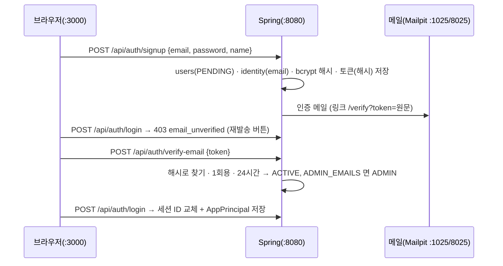
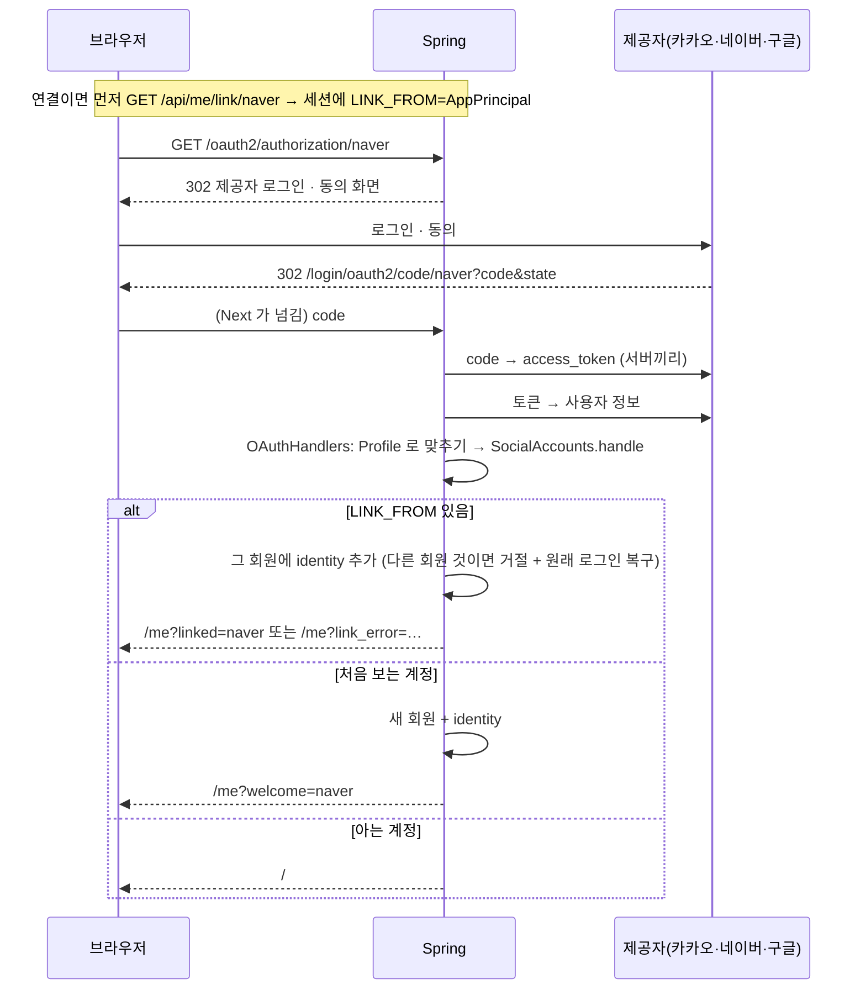

# 2단계 — 회원: 이메일 인증 · 비밀번호 재설정 · 소셜 로그인 · 계정 연결 · 관리자

> 목표: 추천은 누구나 보되, 관심 목록 · 근거 질문 · 피드백 · 관리자 기능은 ‘누구인지’ 알아야 한다.
> 로그인 방법이 넷(이메일 · 카카오 · 네이버 · 구글)이어도 앱 안에서는 **한 가지 모양의 로그인 사용자(AppPrincipal)** 만 보게 만든다.

## 1. 결정 사항 (PRD 11절)

| 주제 | 결정 | 이유 |
|---|---|---|
| 같은 이메일의 소셜 계정 | **자동으로 합치지 않는다.** 마이페이지에서 로그인한 본인이 직접 연결 | 제공자가 준 이메일이 ‘확인된’ 것인지 제공자마다 다르다(네이버는 알려 주지 않음). 남의 계정에 붙는 사고를 막는다 |
| 이메일 가입 | 인증 메일(24시간) 확인 전에는 로그인 불가 · 비밀번호 재설정(30분) | 주소의 주인임을 확인해야 재설정 메일이 의미가 있다 |
| 관리자 | `.env` 의 `ADMIN_EMAILS` 에 있는 **검증된** 이메일 → ADMIN | 관리자 계정을 코드나 DB 시드에 넣지 않는다. 검증 안 된 소셜 이메일로는 관리자가 될 수 없다 |
| 세션 | 서버 세션 + HttpOnly 쿠키, CSRF 는 쿠키(XSRF-TOKEN) → 헤더(X-XSRF-TOKEN) | 화면(3000)이 Spring(8080)을 같은 주소처럼 부르므로(Next rewrites) CORS 도 JWT 도 필요 없다 |

## 2. 표 (Flyway `V1` · `V2`)

```
users ──┬─< user_identity     (provider, provider_user_id) 유일 · (user, provider) 유일
        ├── password_credential (이메일 회원만) — bcrypt 해시 · 연속 실패 수 · 잠금 시각
        ├─< auth_token          VERIFY_EMAIL / RESET_PASSWORD — 원문이 아니라 SHA-256 해시만 저장, 1회용
        └─< favorite            (user, kind=species|area, value)
users.session_version — 비밀번호 재설정 · 변경 · 탈퇴 때 +1 → 다른 기기의 세션이 다음 요청에서 끊긴다
```

이메일 회원도 `user_identity(provider='email', provider_user_id=이메일)` 한 줄을 갖는다. 그래서
“로그인 수단이 몇 개인가”, “마지막 하나는 해제 불가” 같은 규칙을 제공자 구분 없이 한 번에 쓴다.

## 3. 흐름

### 이메일 가입 → 인증 → 로그인



### 비밀번호 재설정

- 요청은 **가입 여부와 상관없이 같은 응답** — 이메일이 회원인지 알아내는 데 쓰이지 않게.
- 새 링크를 보내면 예전 링크는 모두 사용 처리. 링크는 30분, 1회.
- 재설정이 끝나면 `session_version + 1` → **다른 기기의 로그인은 끊기고**, 잠금도 풀린다.
- 로그인 중 비밀번호 변경도 같은 규칙이지만, **지금 기기는** 새 번호로 세션을 다시 만들어 로그인을 유지한다.

### 소셜 로그인 · 계정 연결



**함정 하나**: 제공자에서 돌아온 순간 Spring Security 는 세션의 주인을 ‘제공자 토큰’으로 바꿔 둔다.
연결이 거절되면 그대로 두지 말고 **원래 사람(LINK_FROM)으로 되돌려야** 한다. 그래서 세션에 사용자 번호가 아니라
AppPrincipal 통째로 적어 둔다 (`OAuthHandlers`).

## 4. API

| 메서드 · 경로 | 누가 | 하는 일 |
|---|---|---|
| POST `/api/auth/signup` | 누구나 | 가입 + 인증 메일 (201) |
| POST `/api/auth/verify-email` · `/verify-email/resend` | 누구나 | 인증 · 재발송(1분 간격) |
| POST `/api/auth/login` · `/logout` | 누구나 | 로그인(5회 실패 → 10분 423) · 로그아웃(204) |
| POST `/api/auth/password-reset/request` · `/confirm` | 누구나 | 재설정 메일 · 새 비밀번호 |
| GET `/api/auth/providers` | 누구나 | 화면이 소셜 버튼을 켤지 (키가 없으면 ‘설정 안 됨’) |
| POST `/api/auth/demo-login` | demo 프로필만 | 시연 사용자 · 시연 관리자 (운영에선 404) |
| GET `/api/me` | 회원 | 내 정보 · 로그인 수단 · 관심 목록 |
| PUT `/api/me/favorites` | 회원 | 관심 품목 · 권역 |
| GET `/api/me/link/{provider}` | 회원 | 연결 시작 (302) |
| DELETE `/api/me/identities/{provider}` | 회원 | 연결 해제 (마지막 하나면 409) |
| PUT `/api/me/password` · DELETE `/api/me` | 회원 | 비밀번호 변경 · 탈퇴 |
| `/api/admin/**` | ADMIN | 3단계에서 채움 (지금은 `/ping`) |

오류는 모두 `ProblemDetail` + `code` — 화면은 `code` 로 분기한다 (`email_unverified` → 재발송 버튼, `locked` → 재설정 링크).

## 5. 실습 환경 — 키 없이 끝까지 돌려 보기

| 무엇 | 어떻게 |
|---|---|
| 메일 | [Mailpit](https://mailpit.axllent.org) — SMTP 1025 로 받아 http://localhost:8025 에 보여 준다. 실제로 밖으로 나가지 않는다 |
| 소셜 | `scripts/mock_oauth.py`(:9100, 표준 라이브러리만) + Spring 프로필 `mockoauth`. 우리 코드는 그대로이고 **제공자 주소와 키만** 바뀐다 |
| 시연 | 프로필 `demo` — 로그인 화면의 ‘시연 사용자 · 시연 관리자’ |
| 관리자 | `.env` 에 `ADMIN_EMAILS=admin@fishreco.local` → 그 주소로 가입 · 인증 |

모의 서버를 만들며 만난 일: Java HttpClient 는 `http://` 요청에 `Upgrade: h2c` 헤더를 붙이는데, uvicorn 은 이때 본문을 버려
토큰 교환이 실패했다(422 → 401). 실제 제공자는 https 라 상관없지만, 모의 서버는 업그레이드를 무시하는 `http.server` 로 바꿨다.

### 실제 키로 바꾸기

1. 각 개발자 센터에 앱을 만들고 **Redirect URI** 를 등록한다 — 화면 주소 기준
   - `http://localhost:3000/login/oauth2/code/kakao` · `…/naver` · `…/google`
2. `.env` 에서 해당 줄의 주석을 풀고 키를 넣는다 (`KAKAO_CLIENT_ID=` …). 빈 값으로 두면 서버가 뜨지 않으니 쓰지 않는 제공자는 주석 그대로.
3. `PROFILES=demo scripts/start_all.sh` (mockoauth 빼기). 카카오는 ‘이메일’ 동의 항목을 켜야 이메일이 온다.

`server.forward-headers-strategy=framework` 덕분에 Spring 이 만드는 redirect_uri 가 8080 이 아니라 **3000** 으로 나간다
(Next 가 넘겨 주는 X-Forwarded-Host 를 믿는다).

## 6. 점검

```bash
ai/.venv/bin/python scripts/check_auth.py     # 34개 — 가입 · 메일 · 인증 · 잠금 · 재설정 · 다른 기기 끊김 · 관리자 · CSRF · 소셜 연결
ai/.venv/bin/python scripts/check_all.py      # 통합 점검에 위 결과 한 줄 포함
cd api && ./gradlew test                       # 제공자별 응답 맞추기 · 비밀번호 규칙 · 토큰 해시
```

## 7. 교안 캡처 (`docs/captures/phase2/`, `node scripts/capture/capture.mjs 2`)

| 번호 | 장면 |
|---|---|
| 01 | 로그인 — 이메일 · 소셜 3종(구글은 ‘설정 안 됨’) · 시연 로그인 (PC · 휴대폰) |
| 02–03 | 가입 — 비밀번호 규칙 즉시 안내 · 인증 메일 발송 안내 |
| 04 | 인증 전 로그인 → 막고 재발송 버튼 |
| 05–06 | Mailpit 의 인증 메일 → 확인 완료 |
| 07 | 마이페이지 |
| 08–09 | (모의) 네이버 동의 화면 → 연결 완료 |
| 10–11 | 카카오로 처음 로그인한 다른 사람 · 그 카카오를 연결하려 하면 거절 |
| 12–13 | 관심 품목 · 권역 저장 → 첫 화면이 삼치로, 관심 권역 표시 |
| 14–17 | 비밀번호 찾기 · 재설정 메일 · 새 비밀번호 · 로그인 안내 |
| 18 | 먼저 로그인해 둔 기기는 재설정 순간 끊김 |
| 19 | 5번 틀리면 10분 잠금 |
| 20–21 | 일반 회원의 관리자 화면 403 · 관리자 (PC · 휴대폰) |
